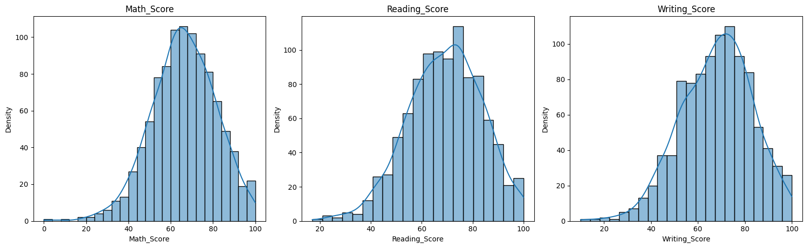
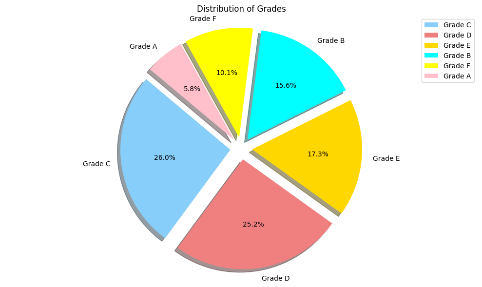

# Students Performance: Analysis and Grade Prediction

Exploratory analysis and classification on the public *Students Performance in Exams* dataset (1,000 students; math, reading and writing scores with a few background attributes). Two Jupyter notebooks explore the data, derive pass/fail status and letter grades, and train classifiers to predict the grade.

> **Read before using the model results:** the notebooks predict `grades` from features that include `percentage` and `status`, which is exactly how `grades` is computed. The near-perfect accuracy is therefore **target leakage**, not evidence of predictive skill. See [Limitations](#limitations).

## Introduction

The dataset records, for 1,000 students, their scores in three exams and five attributes. The notebooks describe how scores relate to gender, parental education, lunch type and test-preparation course, and then build simple classification models.

## Objectives

- Explore and visualise the distribution of exam scores and student attributes.
- Check outliers and compare sample means with reference means (confidence-interval style checks).
- Derive total score, percentage, pass/fail status and letter grade.
- Fit classifiers to predict the grade.

## Dataset

| File | Content |
|---|---|
| `data/StudentsPerformance.csv` | 1,000 rows, 8 columns: `gender`, `race/ethnicity` (groups A to E), `parental level of education`, `lunch`, `test preparation course`, `math score`, `reading score`, `writing score` |

The notebook reads it from the Kaggle path `/kaggle/input/students-performance-in-exams/`, indicating the Kaggle dataset *Students Performance in Exams*. The dataset's licence and original author are not recorded in this repository; check the Kaggle page before reuse.

## Notebooks

| Notebook | Content |
|---|---|
| `notebooks/student-performance.ipynb` | Kaggle-style walkthrough: visualisation, outlier checks, confidence intervals, derived columns (total score, percentage, status, grades), Random Forest classifier with confusion matrix and classification report |
| `notebooks/Student Performance Report.ipynb` | A fuller report version: loads the data from a local MySQL database, repeats the exploration, adds KNN, linear regression, Logistic Regression and Random Forest, and ends with a written summary |

## Technologies

Python, pandas, NumPy, Matplotlib, seaborn, Plotly/cufflinks, SciPy, scikit-learn, MySQL connector (report notebook), Jupyter.

## Derived variables (from the notebooks)

- `total_score` = math + reading + writing; `percentage` = `ceil(total_score / 3)`.
- `status` = *Fail* if the student failed any of the three subjects, otherwise *pass*.
- `grades` = a letter grade from `percentage` and `status` (a *Fail* gets the lowest grade). The report notebook uses grades A to F.



*Figure: distributions of math, reading and writing scores (notebook output).*



*Figure: distribution of derived grades (notebook output).*

## Existing results (as recorded in the notebooks)

Target: `grades`. Features: all other columns, including `total_score`, `percentage` and `status`.

| Notebook | Model | Recorded result | Split |
|---|---|---|---|
| student-performance | Random Forest | training accuracy 1.0, testing accuracy 1.0 | 75/25 (250 test rows) |
| Student Performance Report | KNN | accuracy 0.97 | 80/20 |
| Student Performance Report | Logistic Regression | accuracy 0.92 | 80/20 (200 test rows) |
| Student Performance Report | Random Forest | accuracy 1.00 | 80/20 (200 test rows) |
| Student Performance Report | Linear Regression | R-squared x 100 = 93.42 (printed as "Accuracy of the model") | 80/20 |

The 93.42 value is an R-squared percentage from a regression on encoded grade codes, not a classification accuracy.

## Folder structure

```
Students-Performance-/
├── README.md
├── data/StudentsPerformance.csv
├── notebooks/
│   ├── Student Performance Report.ipynb
│   └── student-performance.ipynb
└── assets/images/            # figures from the notebook outputs
```

The files were originally in the repository root and were moved into folders (contents unchanged). The notebooks load data from a Kaggle path or from a MySQL database, so they do not depend on this layout.

## Installation and usage

```bash
pip install pandas numpy matplotlib seaborn scikit-learn scipy plotly cufflinks missingno jupyter
jupyter notebook notebooks/
```

Library versions were not recorded. To run `student-performance.ipynb` locally, change its data path to `data/StudentsPerformance.csv`. The report notebook expects a local MySQL database named `StudentsPerformance` containing a `studentsperformance` table; it can be adapted to read the CSV instead.

## Limitations

- **Target leakage.** `grades` is a deterministic function of `percentage` and `status`, both of which are inputs. The 1.0 and 0.97 accuracies mostly reflect that rule being learned; they say nothing about predicting grades from background attributes alone. A meaningful experiment would exclude score-derived columns.
- **Mislabelled metric:** the 93.42 "accuracy" is a regression R-squared.
- **Credentials in the notebook.** The report notebook's first cells connect to a local MySQL server with a hard-coded user and password. Credentials should be read from environment variables and the committed value should be changed.
- **Attribution.** `student-performance.ipynb` follows a public Kaggle notebook format and contains the original author's closing request for upvotes; the original author is not credited in the repository. If this notebook is adapted from someone else's work, credit them.
- No tests, no requirements file, and no documented dataset licence.
- Hand-typed numbers appear in plotting cells (for example the grade counts in the pie chart), so some charts are not computed from the data.

## References and acknowledgements

- Dataset: *Students Performance in Exams* on Kaggle (original author not recorded here).
- Libraries: pandas, scikit-learn, seaborn, Matplotlib.
